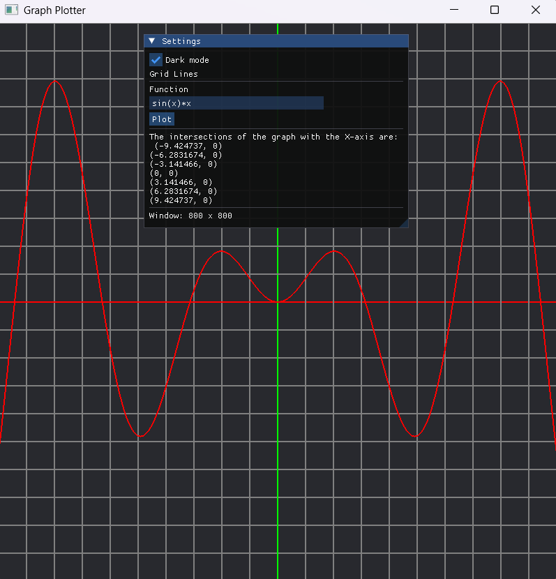

# C++ Function Plotter

A mathematical function plotting application developed in **C++ using OpenGL**. It allows users to enter mathematical expressions and visualize their graphs on a coordinate grid.

The project combines mathematical expression parsing, numerical evaluation, and real-time graphics rendering to transform mathematical functions into visual representations.

## Preview



*Screenshot of the application displaying a plotted mathematical function.*

## Features

- **Function plotting** – visualize mathematical functions on a coordinate system.
- **Mathematical expression parser** – interpret and evaluate user-provided expressions.
- **Arithmetic operations** – addition, subtraction, multiplication, division, and exponentiation.
- **Mathematical functions** – sine, cosine, tangent, square root, logarithm, and absolute value.
- **Mathematical constants** – support for π (`pi`) and Euler's number (`e`).
- **Implicit multiplication** – supports expressions such as `2x` and `3(x+1)`.
- **Coordinate grid** – provides a visual reference for the plotted functions.
- **OpenGL rendering** – renders the grid and graphs using OpenGL.

## Technologies

| Technology | Purpose |
|---|---|
| C++20 | Application logic and mathematical calculations |
| OpenGL | Graphics rendering |
| GLFW | Window creation and input handling |
| GLAD | OpenGL function loading |

### Main Components

| Component | Description |
|---|---|
| `main.cpp` | Application entry point and initialization. |
| `Window` | Handles window creation and management. |
| `Grid` | Responsible for generating and rendering the coordinate grid. |
| `Graph` | Handles function graph generation and rendering. |
| `Expression` | Tokenizes, parses, and evaluates mathematical expressions. |

## Supported Expressions

The expression parser supports several arithmetic operators, mathematical functions, and constants.

### Arithmetic Operators

| Operator | Description | Example |
|---|---|---|
| `+` | Addition | `x + 2` |
| `-` | Subtraction | `x - 3` |
| `*` | Multiplication | `2 * x` |
| `/` | Division | `x / 2` |
| `^` | Exponentiation | `x^2` |

### Mathematical Functions

| Function | Description | Example |
|---|---|---|
| `sin(x)` | Sine | `sin(x)` |
| `cos(x)` | Cosine | `cos(x)` |
| `tan(x)` | Tangent | `tan(x)` |
| `sqrt(x)` | Square root | `sqrt(x)` |
| `log(x)` | Natural logarithm | `log(x)` |
| `abs(x)` | Absolute value | `abs(x)` |

### Mathematical Constants

| Constant | Description |
|---|---|
| `pi` | Mathematical constant π |
| `e` | Euler's number |

### Example Expressions

The following expressions can be entered into the parser:

```text
x^2
sin(x)
cos(x)
tan(x)
2x + 1
sqrt(x)
abs(x)
sin(x) + cos(x)
x^3 - 2x + 1
```

Implicit multiplication is also supported, so expressions such as `2x` are interpreted as `2*x`.

## How It Works

The application uses several components to transform a mathematical expression into a rendered graph.

### 1. Expression Tokenization

The input expression is separated into individual tokens, such as numbers, variables, operators, functions, and parentheses.

For example:

```text
sin(x) + 2x
```

is separated into its corresponding mathematical elements.

### 2. Implicit Multiplication

The parser automatically inserts multiplication operators where they are implied.

For example:

```text
2x       → 2*x
3(x+1)   → 3*(x+1)
```

### 3. Conversion to Reverse Polish Notation

The Shunting-yard algorithm converts the token sequence into Reverse Polish Notation (RPN).

This representation makes it easier to evaluate expressions while respecting operator precedence and associativity.

For example:

```text
2 + 3 * 4
```

becomes:

```text
2 3 4 * +
```

### 4. Expression Evaluation

The resulting RPN expression is evaluated using a stack.

The `Expression` class stores the compiled expression, allowing it to be evaluated repeatedly for different values of `x` without performing tokenization and conversion again.

### 5. Graph Rendering

The graph component uses the evaluated function values to generate points representing the mathematical function. These points are then rendered using OpenGL.

The grid component provides the coordinate reference for the visualization.

## Requirements

Before building the project, make sure you have:

- A C++ compiler with C++20 support.
- OpenGL support.
- GLFW.
- GLAD.
- A compatible graphics environment.
- CMake, if using the CMake build instructions below.

## Building the Project

Clone the repository:

```bash
git clone https://github.com/YOUR_USERNAME/YOUR_REPOSITORY.git
```

Navigate to the project directory:

```bash
cd YOUR_REPOSITORY
```

### Using CMake

If the project contains a `CMakeLists.txt` file, configure and build it with:

```bash
cmake -S . -B build
cmake --build build
```

Make sure the required dependencies are available and correctly configured in your build system.

*Note: These are generic CMake commands. The exact configuration depends on how GLFW, GLAD, and OpenGL are included in the project.*

## Future Improvements

Some possible additions and improvements include:

- Support for additional mathematical functions.
- Better expression validation and error handling.
- Support for scientific notation.
- Multiple functions displayed simultaneously.
- Interactive zooming and panning.
- Customizable graph colors and appearance.
- Improved coordinate grid customization.
- More advanced graph sampling and discontinuity handling.

## License

This project is open source.

---

**Developed with C++, OpenGL, GLFW, and GLAD.**
